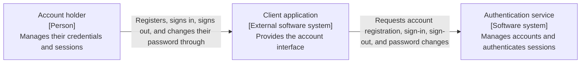
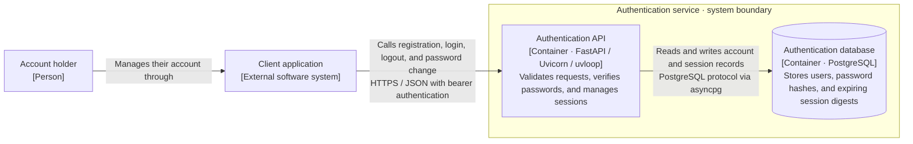

# Authentication service · C4 model

## L1 · System context

The system in scope is the standalone Authentication Service. The client application represents a separate product, such as a website or mobile app, that uses the service. It is an assumed integration in this model.

## L2 · Containers

Each box names its C4 element type. Arrows point from the caller to the system or container it uses. The local Docker environment exposes HTTP for development. HTTPS is the intended boundary for deployed clients.

## Decisions behind the model

- PostgreSQL holds users and sessions so password updates and session revocation can commit in one transaction. Database constraints enforce email uniqueness.
- Login creates a 24-hour opaque bearer session by default. PostgreSQL stores its SHA-256 digest. Logout revokes the presented session. Password change verifies the current password and revokes every session for the account.
- The API and the Docker IPython shell share the same asynchronous database lifecycle. The shell is an alternate entry point in the API image and runs a persistent uvloop so pooled connections can be reused across commands.

[C4 system context](https://c4model.com/diagrams/system-context) · [C4 containers](https://c4model.com/diagrams/container)
